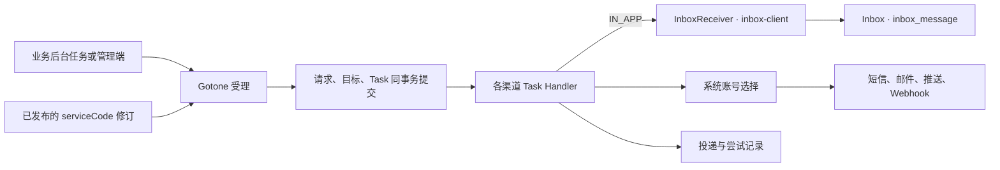

# Gotone 架构

`web` 适配 HTTP 和身份鉴权，`client` 定义调用契约，`core` 实现应用逻辑、渠道集成及 MyBatis-Flex Mapper。一个渠道的一个目标对应一条 Task。Inbox 写入和结果在同一事务，外部尝试在调用前登记，数据库事务之外执行传输。Task 类型分别为 `gotone.deliver.sms`、`gotone.deliver.email`、`gotone.deliver.push`、`gotone.deliver.inbox`、`gotone.deliver.webhook`。可通过 `loadup.task.types` 覆盖每类租约及重试策略，或用 `loadup.task.task-type` 部署专用 Worker。

Framework Task 按任务类型注册五个适配器。`SmsDeliveryHandler`、`EmailDeliveryHandler`、`PushDeliveryHandler` 和 `WebhookDeliveryHandler` 复用外部投递流程，包括供应商调用、限流、超时、重试和尝试记录。Push 和 Webhook 各自处理账号匹配，Webhook 也负责解析目的地凭证。`InboxDeliveryHandler` 负责本地事务投递。

发布配置固定修订和渠道模板，受理时保存每个目标的渲染快照。账号凭证和启用状态按执行时解析。确认未受理的暂时失败可重试并重新选择账号。响应不明时记录 `UNKNOWN`。管理员可登记核对结果，只有确认失败且仍在有效期内的投递可以重试。工作者的尝试序号保护结果更新。请求查询时对账 Task 已耗尽的记录。状态明细只展示脱敏目标、失败码与供应商回执。

Gotone 保管站内信模板和投递记录。`IN_APP` Handler 以 `deliveryId` 作为幂等键调用 `inbox-client` 的 `InboxReceiver`，在同一 JDBC 事务标记 `SENT`。收件人消息副本及已读、归档状态归 Inbox 模块。 [Inbox 模块](../loadup-modules-inbox/README.md)

服务编码、供应商账号、请求和投递的 DataObject 通过 Database processor 生成 Mapper 与表定义。普通查询、分页和字段更新走生成的 Mapper。

PostgreSQL 冲突处理、JSONB 写入、事务防重锁及行锁由仓储使用 Database 组件的 `JdbcClient` 执行。生成的 Mapper、`JdbcClient` 和 Framework Task 共享 Spring 管理的连接与事务。

[接入方式](README.md) · [详细设计](DESIGN.md)
